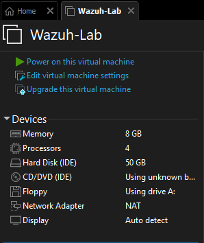
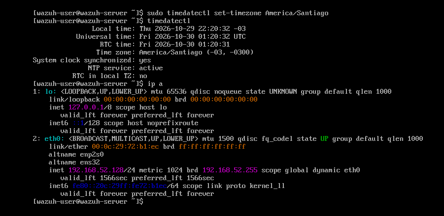
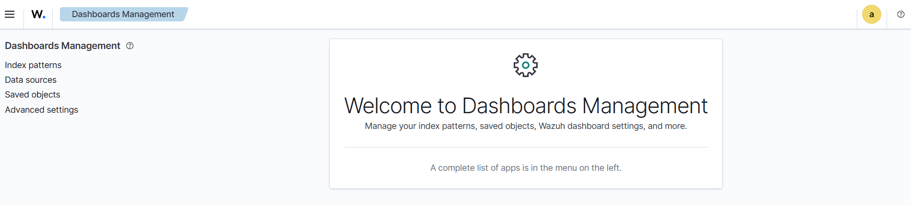

# Lab 01: Instalación de Wazuh

## Objetivo

Montar un SIEM (Security Information and Event Management) en mi propio computador, que funcionará como la "central de monitores" de todo el laboratorio: recibirá los registros de los equipos monitoreados, aplicará reglas y generará alertas.

## Entorno

| Elemento | Detalle |
|---|---|
| Equipo anfitrión | Windows, Intel Core i5-12450H, 16 GB de RAM |
| Virtualización | VMware Workstation Pro |
| SIEM | Wazuh 4.14.9 (máquina virtual oficial en formato OVA, sobre Amazon Linux 2023) |
| Recursos de la VM | 4 núcleos, 8 GB de RAM, 50 GB de disco |
| Red | NAT (aislada de mi red doméstica) |

La máquina de Wazuh incluye sus tres componentes centrales en un solo equipo:

- **Servidor (manager):** recibe los eventos de los agentes y los analiza con reglas.
- **Indexador:** almacena las alertas y permite buscarlas.
- **Panel (dashboard):** la interfaz web donde el analista revisa las alertas.

## Pasos realizados

1. Descargué la máquina virtual oficial `wazuh-4.14.9.ova` desde el sitio de Wazuh.
2. La importé en VMware Workstation (**File > Open**).
3. **Antes de encenderla**, cambié el adaptador de red de *Bridged* a **NAT**.
4. Encendí la máquina e inicié sesión con las credenciales por defecto del sistema.
5. Cambié la contraseña por defecto del usuario del sistema:
   ```bash
   passwd
   ```
6. Configuré la zona horaria de Chile, para que las alertas muestren la hora correcta:
   ```bash
   sudo timedatectl set-timezone America/Santiago
   timedatectl
   ```
7. Obtuve la dirección IP de la máquina:
   ```bash
   ip a
   ```
8. Desde el navegador de mi computador entré al panel en `https://<IP_DE_WAZUH>` y acepté la advertencia del certificado autofirmado.
9. Tomé un **snapshot** en VMware llamado "Wazuh funcionando", como punto de restauración.

## Evidencia

**Configuración de la máquina virtual en VMware:** 8 GB de RAM, 4 procesadores, 50 GB de disco y red NAT.



**Zona horaria e IP:** la hora del sistema quedó en `America/Santiago (-03)` con sincronización NTP activa, y la máquina obtuvo la IP privada `192.168.52.128` dentro de la red NAT del laboratorio.



**Panel web de Wazuh funcionando:** sesión iniciada en el dashboard desde el navegador del equipo anfitrión.



## Decisiones de seguridad

- **Red NAT en lugar de Bridged.** Por defecto, la máquina se conecta directamente a la red de la casa. Con NAT, el laboratorio queda aislado: mis máquinas virtuales se comunican entre sí y mi computador puede acceder a ellas, pero ningún otro dispositivo de mi red las ve.
- **Cambio de credenciales por defecto.** Todas las copias de la máquina de Wazuh vienen con las mismas contraseñas. Dejarlas sin cambiar es uno de los errores más comunes y aprovechados por atacantes.
- **Snapshot antes de seguir.** Si algo se daña en los siguientes laboratorios, puedo volver a un estado funcional en segundos.

## Qué aprendí

1. Qué es un SIEM y cuáles son sus componentes: servidor, indexador y panel.
2. Que la seguridad de una herramienta de seguridad empieza en su instalación: aislar la red y cambiar las credenciales por defecto son lo primero.
3. Que la hora correcta es fundamental en un SOC: sin ella, no se puede reconstruir la línea de tiempo de un incidente.

## Cómo lo aplicaría en un entorno real

En una clínica, el SIEM concentra los registros de servidores, equipos y sistemas clínicos, por lo que es un objetivo valioso para un atacante. Lo instalaría en una red de administración separada, con acceso restringido solo al equipo de seguridad, credenciales únicas, autenticación robusta y respaldos periódicos de su configuración.

## Próximos pasos

- Cambiar también la contraseña del usuario `admin` del panel web, siguiendo la [guía oficial de gestión de contraseñas](https://documentation.wazuh.com/current/user-manual/user-administration/password-management.html).
- Lab 02: conectar un servidor Ubuntu con el agente de Wazuh.
