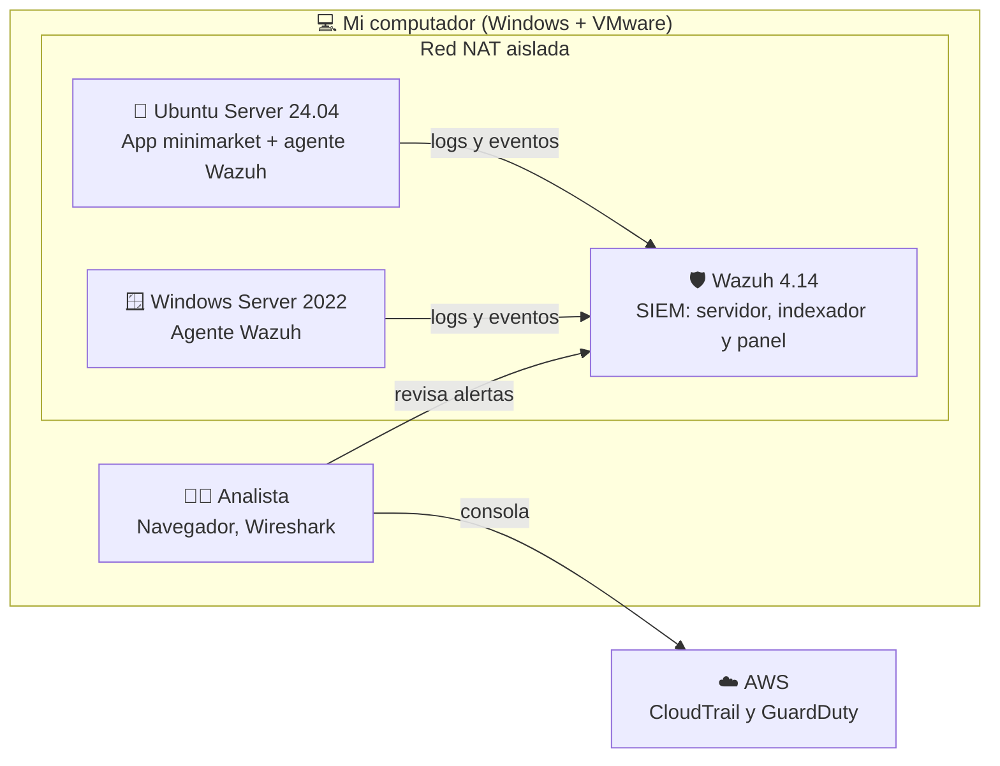

# 🛡️ SOC Home Lab
 
Laboratorio de operaciones de seguridad (SOC) construido en casa para aprender detección y respuesta a incidentes **haciendo**: instalo las herramientas, simulo ataques contra mis propias máquinas, los detecto y documento cada paso.
 
> 🚧 **Proyecto en construcción** (noviembre 2026 – febrero 2027). Cada laboratorio se agrega aquí cuando está terminado y documentado.
 
---
 
## 👩‍💻 Sobre mí
 
Soy **Valeria Castro Maripán**, Técnico de Nivel Superior en Informática y estudiante de último año de Ingeniería en Informática con mención en Ciberseguridad (Chile).
 
Antes de la informática trabajé 5 años como Técnico en Enfermería, 3 de ellos en urgencia adultos. Ahí aprendí a hacer **triage bajo presión**, seguir protocolos estrictos y mantener trazabilidad sin errores. Hoy aplico esa misma forma de trabajar a la seguridad: un SOC también recibe alertas, prioriza por gravedad, investiga y escala a tiempo.
 
Mi objetivo es trabajar como **Analista SOC**, idealmente en el **sector salud**, y especializarme en **Cloud Security**.
 
- 💼 [LinkedIn](https://www.linkedin.com/in/valeria-castro-maripan-6974b3285/)
- 🛒 Proyecto relacionado: [Sistema de inventario seguro para minimarket (Django)](https://github.com/valeriaMaripan/minimarket-seguridad-django)
---
 
## 🗺️ Arquitectura del laboratorio
 
Todo corre en mi computador con VMware Workstation, dentro de una **red NAT aislada** de mi red doméstica.
 

 
| Componente | Función |
|---|---|
| **Wazuh** | SIEM: recibe los registros, aplica reglas y genera alertas |
| **Ubuntu Server** | Servidor Linux monitoreado; ejecuta mi aplicación Django |
| **Windows Server** | Equipo Windows monitoreado (eventos de inicio de sesión, cuentas, grupos) |
| **AWS** | Detección en la nube con CloudTrail y GuardDuty |
 
---
 
## 🧪 Laboratorios
 
| # | Laboratorio | Qué aprendí / detecté | MITRE ATT&CK | Estado |
|---|---|---|---|---|
| 01 | [Instalación de Wazuh](01-wazuh-instalacion/) | Montar un SIEM aislado y cambiar credenciales por defecto | — | ✅ |
| 02 | [Agente en Linux](02-agente-linux/) | Conectar un servidor al SIEM y revisar su configuración (SCA) | — | 🔜 |
| 03 | [Fuerza bruta SSH](03-fuerza-bruta-ssh/) | Detectar intentos masivos de acceso y endurecer SSH | T1110 | 🔜 |
| 04 | [Integridad de archivos](04-integridad-archivos/) | Detectar creación, modificación y borrado de archivos críticos | — | 🔜 |
| 05 | [Logs de seguridad del minimarket](05-minimarket-logs/) | Hacer que mi propia app envíe eventos en formato JSON | — | 🔜 |
| 06 | [Reglas de detección propias](06-reglas-personalizadas/) | Escribir reglas: fuerza bruta, acceso denegado, cambios de precio fuera de horario | T1110 | 🔜 |
| 07 | [Monitoreo de Windows](07-monitoreo-windows/) | Eventos 4624, 4625, 4720 y 4732: logins y cuentas sospechosas | T1136 | 🔜 |
| 08 | [Tráfico con Wireshark](08-wireshark-http/) | Demostrar que HTTP expone contraseñas en texto claro | — | 🔜 |
| 09 | [Análisis de phishing](09-analisis-phishing/) | Revisar cabeceras, SPF, DKIM, DMARC y enlaces sospechosos | T1566 | 🔜 |
| 10 | [Detección en AWS](10-aws-deteccion/) | Investigar actividad con CloudTrail y hallazgos de GuardDuty | — | 🔜 |
| 11 | [Caso integrador: "robo hormiga"](11-caso-incidente/) | Incidente completo: detección, línea de tiempo, informe y playbook | T1110 | 🔜 |
 
**Estado:** ✅ terminado · 🔄 en progreso · 🔜 próximamente
 
---
 
## 🧰 Herramientas y habilidades
 
- **SIEM:** Wazuh (agentes, reglas personalizadas, integridad de archivos, SCA)
- **Sistemas:** Linux (Ubuntu Server), Windows Server, VMware Workstation
- **Redes:** Wireshark, SSH, segmentación con red NAT
- **Cloud:** AWS (IAM, CloudTrail, GuardDuty)
- **Desarrollo:** Python, Django, Git
- **Marcos de referencia:** MITRE ATT&CK
---
 
## 📁 Estructura del repositorio
 
Cada carpeta contiene un `README.md` con objetivo, entorno, pasos, evidencia (capturas), técnica MITRE, lo que aprendí y cómo lo aplicaría en un entorno real.
 
```
soc-homelab/
├── README.md
├── 01-wazuh-instalacion/
├── 02-agente-linux/
├── ...
└── 11-caso-incidente/
```
 
---
 
## ⚠️ Aviso
 
Todas las simulaciones de ataque se realizan **únicamente contra máquinas virtuales propias**, en un entorno aislado y con fines educativos. Este repositorio no contiene contraseñas, llaves ni datos personales reales.
